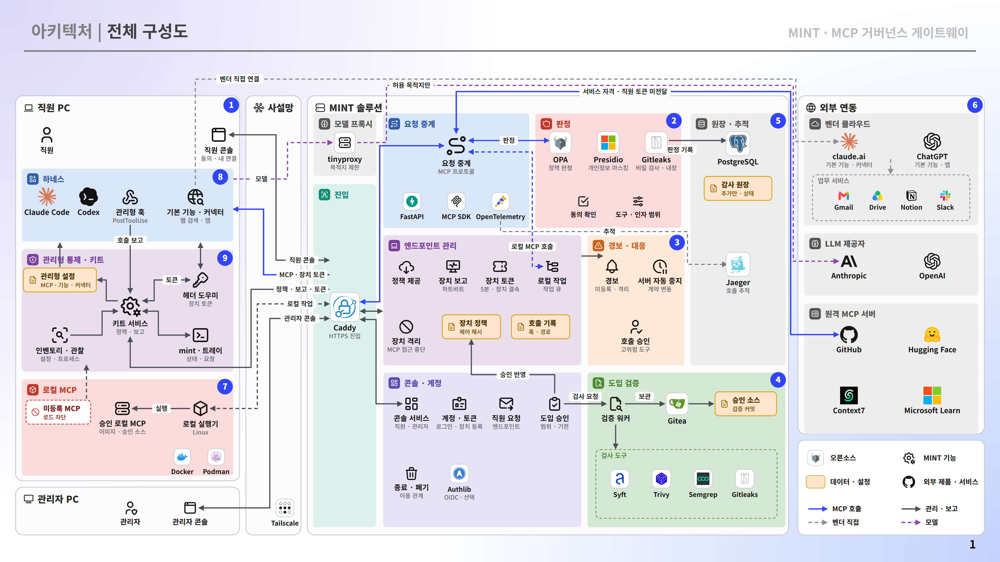

<div align="center">


# MINT

**MCP Governance Gateway**

[한국어](README.md) · **English**


</div>

MINT limits the MCP connections used by AI coding agents on employee PCs (Claude Code and Codex CLI) to the ones the company has approved,
and decides every tool call that passes through the gateway **before it runs**. When an employee requests an MCP onboarding, the request goes through
a supply-chain check and is approved by a different administrator. Only approved servers appear in the managed settings on employee PCs.

Each call is checked for identity, tool classification, input inspection, policy, and usage consent. Personal and secret data detected in responses is masked before
it is returned, responses that cannot be returned safely are withheld, and every decision is written to an append-only audit ledger. When a usage relationship ends, MINT blocks the server immediately
and judges from evidence whether the credentials were revoked.

The employee PC kit deploys the harness's managed settings and reports status. The server installs as a single Docker Compose bundle,
and administrators operate it through the web console and the `./mint.sh` command.

<p align="center">
  
</p>

The trace collector (Jaeger) in the diagram is an optional component that is not part of the production bundle. To use it, install it separately and turn on the connection with `OTEL_SDK_DISABLED=false` and `OTEL_EXPORTER_OTLP_ENDPOINT` in `deploy/.env`. It is off by default.

## Supported environments

| Harness | Status |
| --- | --- |
| Claude Code | Supported |
| Codex CLI | Supported |

| Employee PC operating system | Installation | Status |
| --- | --- | --- |
| Windows 11 (x64) | One installer file, one UAC prompt | Supported |
| Linux (Ubuntu 20.04 or later, x86-64) | One executable file, administrator password once | Supported |
| macOS | One command, administrator password once | Experimental |

| Gateway server | Requirement |
| --- | --- |
| Operating system | Linux x86_64 |
| Software | Docker Engine 24 or later, Docker Compose v2, `git`, `openssl`, `python3` |
| Resources | 4 vCPU, 16 GB memory, 40 GB disk |
| Network | One internal IPv4 address reachable from employee PCs; outbound internet access for image builds and onboarding review |
| Published ports | `443` (console, MCP, authentication) and `3128` (model API proxy for managed harnesses) on that address |

## Quick install

```bash
git clone --branch v1.0.0 https://github.com/MCP-governance/mint.git
cd mint/deploy
./install.sh --bind <internal IPv4>
```

The installer creates `.env`, the secrets, and the signing keys, builds the images and starts the services, then exports the private root certificate to `deploy/ca/root.crt`.
When it finishes, compare the fingerprint in `deploy/ca/root.sha256` through a separate channel, register the root certificate in the browser, and sign in at `https://<internal IPv4>/` as the administrator `root`.
The initial password is in `deploy/initial-admin-password`; change it right away with `./mint.sh set-password root`.

DNS names, trusted certificates (`tailscale` or `file`), solo operation mode, and the settings are described in [deploy/README.md](deploy/README.md).

## Connecting employee PCs

An employee signs in to the console, downloads the installer for their operating system from **PC connection setup**, runs it, and signs in with a MINT account.
The installer contains the gateway address, the root certificate, and its fingerprint. It does not contain a per-employee enrollment token.

| Operating system | Installer | How to run |
| --- | --- | --- |
| Windows | `mcp-managed-setup-windows.exe` | Run the downloaded file and approve the UAC prompt once. The installer is not code-signed, so if Windows shows an "Unknown publisher" warning, choose **Run** once more. |
| Linux | `mcp-managed-setup-linux` | The browser does not set the execute permission, so run `chmod +x` and then start it from a terminal. Enter the administrator password once. x86-64 only. |
| macOS | `mcp-connect-macos.command` | Run it from a terminal with `/bin/bash "$HOME/Downloads/mcp-connect-macos.command"`. Enter the administrator password once. Run the file within five minutes of downloading it. If it expires or the attempt fails, download a new file. |

On Linux, use the command shown in the console as it is.

```bash
f="$(ls -t ~/Downloads/mcp-managed-setup-linux* | head -1)" && chmod +x "$f" && "$f"
```

On Windows and Linux the default is Simple mode, which installs into the signed-in employee account. After the installation check passes, the PC is activated automatically according to the organization's settings.
If you choose **Advanced: isolated account** in **PC connection setup**, the harness is isolated in a separate managed account with firewall and access restrictions, and an administrator activates it in **Endpoint management**.
On macOS the kit installs into a separate managed account and is not activated automatically, so an administrator activates it in **Endpoint management**.
On Windows and Linux, run `mint` in a new terminal after installation to see the status, MCP servers, call logs, and onboarding requests.
For what the installer sets up, removal, and troubleshooting, see [endpoint-agent/README.md](endpoint-agent/README.md).

## Operations

| Task | Where |
| --- | --- |
| To-do items and decision summary, call approvals | Console **Dashboard** |
| Call lookup | Console **Call logs** |
| Alerts, incident reports, monitoring integration | Console **Security monitoring** |
| MCP server audience and suspension, control of built-in features and connectors | Console **AI connection management** |
| Accounts, usage suspension, sign-up requests | Console **User management** |
| Employee PC activation and status | Console **Endpoint management** |
| Policy review | Console **Security management policies** |
| MCP onboarding request, review, and approval | Console **Adoption management** (employee menu: **Onboarding**; page title: **Onboarding requests**) |
| Ending a usage relationship, revocation evidence | Console **Termination and disposal** |
| Tool usage consent | Console **Tool usage consent** |
| Employee PC installers | Console **PC connection setup** |

| Command (run in `deploy/`) | What it does |
| --- | --- |
| `./mint.sh status` | Service status, version, readiness |
| `./mint.sh up [--with-siem]` | Start or restart |
| `./mint.sh add-account <id> --role 관리자\|직원` | Add an account (`관리자` is administrator, `직원` is employee; `admin` and `user` are also accepted) |
| `./mint.sh set-password <id>` | Change a password |
| `./mint.sh ca` | Re-export the root certificate and fingerprint |
| `./mint.sh backup [directory]` · `restore <backup>` | Back up and restore |
| `./mint.sh upgrade` | Back up, then restart on the current version |
| `./mint.sh logs [service]` · `down` | Logs · stop (data is kept) |
| `./mint.sh litellm enable\|check\|status\|rotate-key\|disable` | LiteLLM integration |

A production deployment uses independent approval by default: a request is approved by an administrator other than the requester.
When solo operation is needed, set `ROOT_SOLO_APPROVAL=1` in `.env` so that the top-level administrator `root` can approve its own requests. Such approvals are recorded separately in the ledger.

## Security boundaries

- **Identity comes only from the transport-layer token.** Values in arguments, headers, or reported by the client are recorded but not used in decisions.
- **Employee tokens are never forwarded to upstream MCP servers.** The gateway holds per-server credentials separately.
- **If it cannot decide, it blocks.** If the policy engine or an inspector fails, the call is blocked. Data whose classification is unclear is treated as important and decided under policy.
- **The gateway controls only calls that pass through its path.** PCs without the kit, unmanaged accounts, and vendor default connectors are the responsibility of endpoint, network, and vendor settings; the console shows them as a control status.
- **Simple mode does not prevent endpoint bypass.** The gateway's pre-execution decision applies, but another process in the employee account that reaches the outside without going through the gateway must be covered by other controls such as EDR, DLP, or a proxy. Without such controls, use the isolated account.
- **A termination verdict is a judgment based on the evidence collected and submitted, within the scope that evidence establishes.** It does not directly verify that the provider actually revoked the credentials.

## Documentation

| Document | Contents |
| --- | --- |
| [deploy/README.md](deploy/README.md) | Server installation, console certificate, operations commands, service layout |
| [endpoint-agent/README.md](endpoint-agent/README.md) | Employee PC kit installation, the `mint` command, removal |
| [addons/litellm/README.md](addons/litellm/README.md) | LiteLLM integration |
| [policy/README.md](policy/README.md) | Security policy code (OPA/Rego) |
| [CHANGELOG.md](CHANGELOG.md) | Changes by version |

For the MCP specification see [modelcontextprotocol.io](https://modelcontextprotocol.io), for the container environment see [docs.docker.com](https://docs.docker.com), and for the policy engine see [openpolicyagent.org](https://www.openpolicyagent.org).

## License

No open-source license has been specified yet. Copying, distributing, or modifying this software without the copyright holder's permission is not allowed.
The bundled third-party components (OPA, Presidio, Caddy, Gitea, PostgreSQL, and others) are governed by their own licenses.
