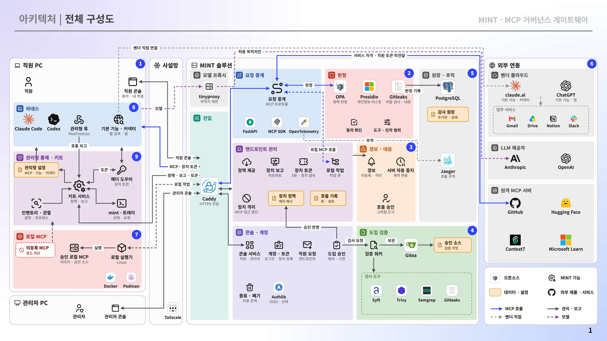

<div align="center">


# MINT

**MCP 거버넌스 게이트웨이**

**한국어** · [English](README.en.md)


</div>

MINT는 직원 PC의 AI 코딩 에이전트(Claude Code·Codex CLI)가 쓰는 MCP 연결을 회사가 승인한 것으로 한정하고,
게이트웨이를 지나는 도구 호출을 **실행 전에** 판정하는 제품입니다. 직원이 MCP 도입을 신청하면 공급망 검사를 거쳐 다른 관리자가 승인하고,
승인된 서버만 직원 PC의 관리형 설정에 올라갑니다.

호출마다 신원·도구 분류·입력 검사·정책·이용 동의를 확인합니다. 응답에 든 개인정보와 비밀 정보는 가린 뒤 돌려주고,
모든 판정은 덧붙이기만 하는 감사 원장에 남깁니다. 이용 관계를 끝내면 해당 서버를 즉시 막고, 자격 회수 여부를 증거로 판정합니다.

직원 PC 키트는 하네스의 관리형 설정을 배포하고 상태를 보고합니다. 서버는 Docker Compose 묶음 하나로 설치하며,
관리자는 웹 콘솔과 `./mint.sh` 명령으로 운영합니다.

<p align="center">
  
</p>

## 지원 범위

| 하네스 | 상태 |
| --- | --- |
| Claude Code | 지원 |
| Codex CLI | 지원 |

| 직원 PC 운영체제 | 설치 | 상태 |
| --- | --- | --- |
| Windows 11 (x64) | 설치 파일 하나, UAC 1회 | 지원 |
| Linux (Ubuntu 20.04 이상, x86-64) | 실행 파일 하나, 관리자 암호 1회 | 지원 |
| macOS | 명령 한 줄, 관리자 암호 1회 | 시험 |

| 게이트웨이 서버 | 요구 사항 |
| --- | --- |
| 운영체제 | Linux x86_64 |
| 소프트웨어 | Docker Engine 24 이상, Docker Compose v2, `git`, `openssl`, `python3` |
| 자원 | 4 vCPU · 16 GB 메모리 · 40 GB 디스크 |
| 네트워크 | 직원 PC가 닿는 사내 IPv4 하나, 이미지 빌드와 도입 심사를 위한 인터넷 출구 |
| 게시 포트 | 그 주소의 `443`(콘솔·MCP·인증), `3128`(관리형 하네스의 모델 API 프록시) |

## 빠른 설치

```bash
git clone --branch v1.0.0 https://github.com/MCP-governance/mint.git
cd mint/deploy
./install.sh --bind <사내 IPv4>
```

설치기는 `.env`와 비밀 값·서명 키를 만들고, 이미지를 빌드해 서비스를 올린 뒤 사설 루트 인증서를 `deploy/ca/root.crt`로 내보냅니다.
끝나면 `https://<사내 IPv4>/`에서 관리자 `root`로 로그인합니다. 초기 비밀번호는 `deploy/initial-admin-password`에 있으며,
`./mint.sh set-password root`로 바로 바꿉니다. 브라우저에는 `deploy/ca/root.sha256` 지문을 대조한 뒤 루트 인증서를 등록합니다.

DNS 이름 지정, 신뢰된 인증서(`tailscale`·`file`) 사용, 단독 운영 모드, 설정 값은 [deploy/README.md](deploy/README.md)에 있습니다.

## 직원 PC 연결

직원은 콘솔에 로그인해 **PC 연결 설정**에서 자기 운영체제의 설치 파일을 받아 실행하고, MINT 계정으로 로그인합니다.
설치 파일에는 게이트웨이 주소·루트 인증서·지문이 들어 있고 직원별 등록 토큰은 없습니다.

| 운영체제 | 설치 파일 | 실행 방법 |
| --- | --- | --- |
| Windows | `mcp-managed-setup-windows.exe` | 받은 파일을 실행하고 UAC를 한 번 승인합니다. 코드 서명이 없어 Windows가 「알 수 없는 게시자」 경고를 보이면 **실행**을 한 번 더 누릅니다. |
| Linux | `mcp-managed-setup-linux` | 브라우저가 실행 권한을 주지 않으므로 `chmod +x`를 한 뒤 터미널에서 실행합니다. 관리자 암호를 한 번 입력합니다. x86-64 전용입니다. |
| macOS | `mcp-connect-macos.command` | 터미널에서 `/bin/bash "$HOME/Downloads/mcp-connect-macos.command"`로 실행합니다. 관리자 암호를 한 번 입력합니다. |

Linux는 콘솔에 표시되는 아래 명령을 그대로 씁니다.

```bash
f="$(ls -t ~/Downloads/mcp-managed-setup-linux* | head -1)" && chmod +x "$f" && "$f"
```

기본은 간편 모드로, 로그인한 직원 계정에 설치합니다. 설치 점검을 통과하면 조직 설정에 따라 자동으로 활성화됩니다.
콘솔의 **PC 연결 설정**에서 **고급: 격리 계정**을 고르면 별도 관리 계정과 방화벽·접근 제한으로 하네스를 격리하며, 관리자가 **엔드포인트 관리**에서 활성화합니다.
설치 뒤에는 새 터미널에서 `mint`를 실행해 상태·MCP 서버·호출 기록·도입 요청을 확인합니다.
설치 내용, 제거, 문제 해결은 [endpoint-agent/README.md](endpoint-agent/README.md)를 봅니다.

## 운영

| 일 | 어디서 |
| --- | --- |
| 처리할 일·판정 요약, 호출 승인 | 콘솔 **대시보드** |
| 호출 조회 | 콘솔 **호출 기록** |
| 경보·사고 보고·관제 연동 | 콘솔 **보안 관제** |
| MCP 서버 사용 대상·중지, 기본 기능·커넥터 통제 | 콘솔 **AI 연결 관리** |
| 계정·이용 중지·가입 요청 | 콘솔 **사용자 관리** |
| 직원 PC 활성화·상태 | 콘솔 **엔드포인트 관리** |
| 정책 확인 | 콘솔 **보안 관리 정책** |
| MCP 도입 신청·검토·승인 | 콘솔 **도입 관리**(직원 화면은 **도입 신청**) |
| 이용 관계 종료·회수 증거 | 콘솔 **종료 및 폐기** |
| 도구 이용 동의 | 콘솔 **도구 이용 동의** |
| 직원 PC 설치 파일 | 콘솔 **PC 연결 설정** |

| 명령(`deploy/`에서 실행) | 하는 일 |
| --- | --- |
| `./mint.sh status` | 서비스 상태, 판본, 준비 여부 |
| `./mint.sh up [--with-siem]` | 기동·재기동 |
| `./mint.sh add-account <아이디> --role 관리자\|직원` | 계정 추가 |
| `./mint.sh set-password <아이디>` | 비밀번호 변경 |
| `./mint.sh ca` | 루트 인증서와 지문 다시 내보내기 |
| `./mint.sh backup [디렉터리]` · `restore <백업>` | 백업·복구 |
| `./mint.sh upgrade` | 백업 뒤 현재 판본으로 재기동 |
| `./mint.sh logs [서비스]` · `down` | 로그 · 정지(데이터 유지) |
| `./mint.sh litellm enable\|check\|status\|rotate-key\|disable` | LiteLLM 연동 |

운영 배포의 기본은 독립 승인입니다. 본인 신청은 다른 관리자가 승인합니다.
단독 운영이 필요하면 `.env`의 `ROOT_SOLO_APPROVAL=1`로 최고 관리자 `root`가 본인 신청을 승인하게 할 수 있으며, 이 승인은 원장에 따로 기록됩니다.

## 보안 경계

- **신원은 전송 계층의 토큰에서만** 정합니다. 인자·헤더·클라이언트가 보고한 값은 기록만 하고 판정에 쓰지 않습니다.
- **직원 토큰을 업스트림 MCP로 넘기지 않습니다.** 서버별 자격은 게이트웨이가 따로 보관합니다.
- **판정할 수 없으면 막습니다.** 정책 엔진·검사기가 실패하거나 도구 분류를 모르면 차단합니다.
- **게이트웨이는 자기 경로를 지나는 호출만 통제합니다.** 키트가 없는 PC, 관리되지 않는 계정, 벤더 기본 커넥터는 엔드포인트·네트워크·벤더 설정의 몫이며, 콘솔에는 통제 상태로 표시합니다.
- **간편 모드는 엔드포인트 우회를 막지 않습니다.** 게이트웨이의 호출 전 판정은 적용되지만, 직원 계정의 다른 프로세스가 게이트웨이를 거치지 않고 외부로 나가는 것은 EDR·DLP·프록시 같은 다른 통제가 받쳐야 합니다. 그런 통제가 없으면 격리 계정을 씁니다.
- **종료 판정은 공개된 증거로 내린 판단입니다.** 제공자의 실제 회수를 직접 검증하는 것은 아닙니다.

## 문서

| 문서 | 내용 |
| --- | --- |
| [deploy/README.md](deploy/README.md) | 서버 설치, 콘솔 인증서, 운영 명령, 서비스 구성 |
| [endpoint-agent/README.md](endpoint-agent/README.md) | 직원 PC 키트 설치·`mint` 명령·제거 |
| [addons/litellm/README.md](addons/litellm/README.md) | LiteLLM 연동 |
| [policy/README.md](policy/README.md) | 보안 정책 코드(OPA/Rego) |
| [CHANGELOG.md](CHANGELOG.md) | 판본별 변경 |

MCP 규격은 [modelcontextprotocol.io](https://modelcontextprotocol.io), 컨테이너 환경은 [docs.docker.com](https://docs.docker.com), 정책 엔진은 [openpolicyagent.org](https://www.openpolicyagent.org)를 참고합니다.

## 라이선스

아직 오픈소스 라이선스를 지정하지 않았습니다. 저작권자의 허락 없이 복제·배포·수정할 수 없습니다.
포함된 제3자 구성요소(OPA, Presidio, Caddy, Gitea, PostgreSQL 등)는 각자의 라이선스를 따릅니다.
