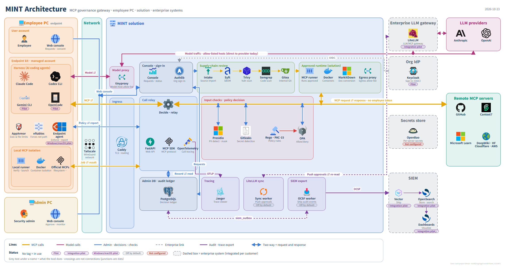

<div align="center">


# MINT

**MCP governance gateway** — decides every MCP tool call from employees' AI agents **before** it runs, and records every decision in an audit ledger.

[한국어](README.md) · **English**

[](https://github.com/MCP-governance/mcp-gateway/actions/workflows/verify.yml)
[](https://github.com/MCP-governance/mcp-gateway/actions/workflows/codeql.yml)


</div>

<p align="center">
  
</p>

<p align="center"><sub>Read left to right in the order a tool call travels. Two-way arrows carry requests and responses; grey text under each name says what the tool does.
An annotated version is <a href="docs/ai/architecture/mint-architecture-roles-en.png">here</a>, and the editable source is <a href="docs/ai/architecture/mint-architecture-en.drawio">draw.io</a>.</sub></p>

---

## Why MINT

Coding agents such as Claude Code and Codex use MCP servers to read files, repositories, internal documents and external services.
When every employee wires up their own MCP servers, the company cannot tell **who used which tool on which data, and where it went**.
MINT routes every MCP connection through one gateway and makes sure the employee PC cannot go around it.

- **Before it comes in** — an MCP server is requested, scanned for supply-chain risk and approved by a person. New tool contracts are never auto-approved.
- **Before it runs** — each call goes through identity, resource classification, input checks, a policy decision and consent. If MINT cannot decide, it blocks.
- **Before it returns** — personal data and secrets are masked in the response, which must match the approved contract.
- **When it ends** — closing a relationship blocks access at once, and whether the access was actually revoked is judged on evidence.

## Features

| Feature | What it does |
| --- | --- |
| **Intake review** | Request a GitHub repository or remote MCP URL → Syft, Trivy and Semgrep scans → import into internal Gitea → one-click approval (per-tool read/write class, validity, data grade) |
| **Pre-call decisions** | OPA/Rego policy with PAC-15 execution scope, approved input schemas, purpose binding, cross-server flow limits, rate and duplicate-execution limits |
| **Input & output checks** | Presidio (personal data), Gitleaks (secrets), text rules, tool-description poisoning checks. A failed checker blocks the call |
| **Consent** | Employees grant or revoke data use per server; each tool's consent is kept in the ledger |
| **Endpoint enforcement** | The PC kit uses a managed account, AppArmor and nftables so MCP traffic can only reach the gateway, and reports config tampering and rogue listeners |
| **Local MCP isolation** | Approved local MCPs (official filesystem, memory, …) run on the employee PC in Docker after a signature check, with only the chosen folders mounted |
| **Audit ledger** | Append-only, hash-chained record of every decision, approval and consent. OpenTelemetry tracing and OCSF export to a SIEM |
| **Termination** | Ending a relationship blocks immediately and judges revocation from evidence (C1–C4 → T1–T3) |
| **Enterprise integration** | Org IdP (OIDC), LiteLLM approval/revocation sync, SIEM — optional, enabled per customer |
| **Console** | Korean/English switch, dark mode, labels and values only |

## How it works

The path of one tool call; the numbers match the red numbers in the diagram.

1. **Harness call** — Claude Code or Codex CLI calls an MCP tool from the managed account. The endpoint blocks every other route.
2. **HTTPS ingress** — Over the Tailscale network, Caddy terminates HTTPS and hands the call to the relay.
3. **Input checks** — Identity comes from the transport token; Presidio and Gitleaks inspect and mask the input.
4. **Policy decision** — OPA decides allow, deny or needs-approval with Rego and PAC-15 rules, asking for employee consent when required.
5. **Relay to the MCP server** — Only to approved servers, with per-server credentials. Employee tokens are never forwarded.
6. **Response check & record** — The response is inspected and masked on the way back, and the decision and outcome go into the PostgreSQL ledger.

## Components

| Area | Open source | Role |
| --- | --- | --- |
| Employee PC | Claude Code · Codex CLI (Gemini CLI · OpenCode pilot) | AI coding agents (harnesses) |
| | AppArmor · nftables · endpoint agent | Exec and file limits, forced network path, policy enforcement and reporting |
| | Docker · local runner | Isolated runs of approved local MCPs |
| Network | Tailscale | WireGuard private network between PCs and the solution |
| Ingress | Caddy · tinyproxy | TLS termination and routing, model host allow-list |
| Console | FastAPI · Authlib | Requests, approvals and status; org sign-in (OIDC) |
| Supply chain | Syft · Trivy · Semgrep · Gitea | SBOM, vulnerability scan, code scan, internal Git |
| Runtime | Docker · MarkItDown · egress proxy | Runs approved servers, document-conversion MCP, egress allow-list |
| Call relay | FastAPI · MCP Python SDK · OpenTelemetry | Web API, MCP protocol, call tracing |
| Checks & policy | Presidio · Gitleaks · OPA | PII detection and masking, secret detection, allow/deny decisions |
| Record & export | PostgreSQL · Jaeger | Decision and approval ledger, trace viewer |
| Enterprise (optional) | Keycloak · LiteLLM · OpenBao · Vector · OpenSearch | Org IdP, LLM gateway, secrets store, SIEM |

## Quick start

On the solution host (Linux or WSL2 with Docker Compose and Tailscale):

```bash
git clone https://github.com/MCP-governance/mcp-gateway.git
cd mcp-gateway/full_stack_lab
./console.sh field up
./console.sh field status
```

- Browser console: `http://<Tailscale IP>:8000/login`
- Harness and kit endpoint: `https://<Tailscale IP>` — check the deployment root and its SHA-256 fingerprint with `./console.sh field ca` and follow the [CA distribution steps](docs/ai/FIELD.md#현장-tls와-루트-배포d-124).
- First-install accounts are admin `root`/`root` and employee `user`/`user`. Change them after testing with `./console.sh field set-password root`.

### First run

1. **Request** — An employee requests a GitHub repository or remote MCP URL in the console. Official MCPs (filesystem, memory, sequentialthinking) come with the PC isolation settings pre-filled.
2. **Approve & register** — Another admin reviews the scan results, sets tool classes, data grade and validity, and approves in one click.
3. **Connect the PC** — The employee installs a personal kit (Linux, single-file Windows installer, macOS command). An admin activates the endpoint.
4. **Use** — Approved MCPs appear in the harness. The first use asks for consent once per server.
5. **End** — Closing the relationship blocks at once and judges revocation from evidence.

Commands, accounts and troubleshooting are in the [RUNBOOK](docs/ai/RUNBOOK.md) (Korean); the lab company stack is in [full_stack_lab](full_stack_lab/README.md).

## Verified with real MCP servers

MINT is not validated against home-made mock MCPs. Real public MCP servers are requested, approved and called from a real employee PC's harness.

| Runs on | MCP servers |
| --- | --- |
| Remote | GitHub · Context7 · Microsoft Learn · DeepWiki · Hugging Face · Cloudflare Docs · AWS Knowledge |
| Solution runtime | MarkItDown |
| Employee PC isolation | filesystem · memory · sequentialthinking (official modelcontextprotocol/servers images) |

Latest field run: [three local MCPs end to end on PJ1](research/llm-wiki/status/reports/2026-10-23-real-usage-local-mcp.md) (Korean).

## Principles

These hold however the implementation changes. If one has to change, the principle is discussed before the feature.

1. **Identity comes only from the transport token.** Values in arguments, headers or client reports are recorded, never used to decide.
2. **Employee tokens are never passed to upstream MCP servers** (no token passthrough, per the MCP authorization spec).
3. **If it cannot decide, it blocks.** A failing policy engine, checker or contract check, or an unknown class, means deny.
4. **People approve.** New tool contracts are never auto-approved, and the requester cannot approve their own request.
5. **The audit ledger is append-only.** Decision records are never edited or deleted.
6. **Disabled is not revoked.** Termination blocks first and judges revocation on evidence.
7. **Verified with real things.** Test targets are commercial or public open-source MCP servers only.

Detailed invariants for agents are in [AGENTS.md](AGENTS.md); changeable choices and their reasons are in [DECISIONS.md](docs/ai/DECISIONS.md) (Korean).

## Documentation

Most design and research documents are written in Korean.

| Path | Contents |
| --- | --- |
| [docs/ai/](docs/ai/README.md) | Design ([ARCHITECTURE](docs/ai/ARCHITECTURE.md)), security boundaries, policy, termination model, tests, decisions |
| [docs/ai/architecture/](docs/ai/architecture/README.md) | Diagram sources (draw.io, SVG, PNG in Korean and English) and generator |
| [research/llm-wiki/](research/llm-wiki/README.md) | Development status, work reports, requirement analysis, experiment evidence |
| [full_stack_lab/](full_stack_lab/README.md) | Gateway, console, policy, tests and lab stack |
| [endpoint-agent/](endpoint-agent/README.md) | Employee PC kit and endpoint agent |
| [AGENTS.md](AGENTS.md) | Rules for people and agents working in this repository |

## Status and limits

- **Deployment** — Tailscale IP only, private-CA HTTPS. Harnesses must trust the root distributed by the kit.
- **Enforcement scope** — The gateway controls calls **inside** the enforced path. Unmanaged accounts, PCs without the kit and vendor default connectors are left to endpoint, network and vendor admin settings, and the console marks them as bypassable ([security boundaries](docs/ai/SECURITY_BOUNDARIES.md)).
- **Endpoints** — The Linux kit is verified on real hardware. The single-file Windows installer and the macOS kit are implemented and tested, but not yet verified on real machines.
- **Integrations** — LiteLLM sync and SIEM export are off by default; OpenBao integration does not exist yet.
- **Termination** — Conclusions are judgements from published evidence, not verification of a provider's actual revocation.
