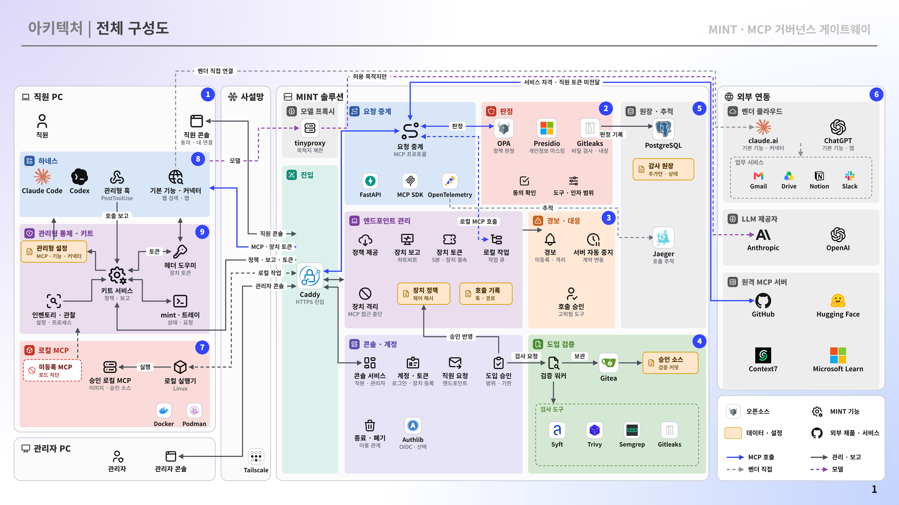

<div align="center">


# MINT

**MCP Governance Gateway**

[한국어](README.md) · **English**

[](https://github.com/MCP-governance/mcp-gateway/actions/workflows/verify.yml)
[](https://github.com/MCP-governance/mcp-gateway/actions/workflows/codeql.yml)


</div>

MINT limits managed MCP connections used by AI coding agents on employee PCs (Claude Code, Codex CLI) to company-approved servers, and judges each
tool call that passes through the gateway **before it runs**. An employee requests an MCP server, it goes through supply-chain checks, and a different administrator approves it.
Each call is checked for identity, tool classification, input inspection, policy and consent; personal and secret data are masked in the response, and every
decision is appended to an append-only audit ledger. The endpoint kit deploys managed harness settings so that only the approved path is used, and when a
relationship ends MINT blocks it immediately and judges, from evidence, whether access was actually revoked.

<p align="center">
  
</p>

<p align="center"><sub><a href="docs/ai/architecture/v2-1101/p02.png">Areas (Korean)</a> · <a href="docs/ai/architecture/README.md">All 29 pages and generator</a></sub></p>

## Support

| Harness | Status |
| --- | --- |
| Claude Code | Supported |
| Codex CLI | Supported |
| Gemini CLI · OpenCode | Tested in the lab stack |

| Employee PC | Install | Status |
| --- | --- | --- |
| Linux (Ubuntu 20.04–26.04) | One command, one sudo | Supported |
| Windows 11 | One file, one UAC prompt | Supported |
| macOS | One command | Preview |

| Server | Requirements |
| --- | --- |
| Gateway server | Linux x86_64, Docker Engine 24+, Docker Compose v2 |

## Five-minute install

The install example uses the public `v0.10.0` release of the deployment repository [MCP-governance/mint](https://github.com/MCP-governance/mint). The current-code descriptions in this README also include [unreleased changes](CHANGELOG.md#미배포).

```bash
git clone --branch v0.10.0 https://github.com/MCP-governance/mint.git
cd mint/deploy
./install.sh --bind <internal IPv4>
```

Then sign in at `https://<internal IPv4>/` as the administrator `root`. The initial password is in `deploy/initial-admin-password`;
change it with `./mint.sh set-password root`. Requirements, components and options are in [deploy/README.md](deploy/README.md) (Korean).

## Connecting employee PCs

1. The employee signs in to the console and downloads the kit for their OS from **PC connection settings**.
2. They run it and sign in with their MINT account (one command on Linux and macOS, one file on Windows). The kit carries the gateway address, root certificate and fingerprint, without an employee enrollment token.
3. Default simple mode activates according to installation checks and the organization's automatic activation setting. Isolated account mode requires administrator activation under **Users & endpoints**. Consent is handled in the signed-in console after reviewing the server and tool scope.

Employees use the `mint` terminal screen or `mint ui` local screen for status, MCP servers, call history and onboarding requests.
Commands also include `mint servers`, `mint logs [number]`, `mint requests`, `mint request`, `mint sources [server]`, `mint login` and `mint console [page]`.
Approved source MCPs run as stdio processes on the endpoint; the official-image endpoint container path is also retained.

What the kit installs, how to remove it and troubleshooting are in the [endpoint kit](endpoint-agent/README.md) guide.

## Operations

| Task | Where |
| --- | --- |
| MCP requests and approval | Console **Onboarding requests**, **Pending approval** |
| Audience, suspension and revocation of approved servers | Console **MCP servers** |
| Endpoint activation and control status | Console **Users & endpoints**, **MCP servers > Control coverage** |
| Decisions, consent and audit | Console **Calls & audit records**; administrator **Pending approval > Usage consent**, employee **Usage consent** |
| Connectors and built-in harness features | Console **MCP servers > Connectors**, **Policy > Harness features** |
| Accounts and passwords | `./mint.sh add-account`, `./mint.sh set-password` |
| Backup, restore, upgrade, rollback | `./mint.sh backup`·`restore`·`upgrade` — [runbook](docs/ai/RUNBOOK.md) (Korean) |
| Changes per version | [CHANGELOG.md](CHANGELOG.md) (Korean) |

The dashboard shows pending tasks, decisions over time, calls per server and recent alerts. Call details separate route, policy decision, tool execution and business outcome.
Alert periods, grouping and unread counts, endpoint search, and URL restoration of details, filters and pages are available. See [development status](research/llm-wiki/status/current.md) for deployment and device validation limits.

Production defaults to independent approval. In single-operator mode (`ROOT_SOLO_APPROVAL=1`), super administrator `root` can force approval of their own requests and satisfy the two-administrator condition for high risk;
the ledger records this separately. Very high risk still requires a written justification. Change the default passwords of field administrators `admin1`–`admin3` after first startup; production disables accounts that retain their default passwords.

## Security boundaries

- **Identity comes only from the transport token.** Identities in arguments, headers or client reports are recorded, never used for decisions.
- **Employee tokens are never passed to upstream MCP servers.** The gateway holds per-server credentials, and credentials employees connect are encrypted with an organization key.
- **If it cannot decide, it blocks.** A failed policy engine, inspector or contract check, or an unknown classification, means deny.
- **The gateway controls only the calls on its path.** Unmanaged accounts, PCs without the kit and vendor built-in connectors belong to endpoint, network and vendor management; the console shows their control status.
- **Built-in features and connectors are approved by default; per-item blocks propagate through managed settings.** Vendor-direct calls bypass gateway pre-execution decisions. Managed post-call hooks in Claude Code and Codex report names, sizes, hashes and failures centrally, while unregistered MCP observations raise alerts. Deletable records and missing hook execution prevent claims of complete collection or pre-execution blocking.
- **Termination verdicts are judgments from public evidence,** not verification of the provider's actual revocation.

The detailed threat model and limits are in [security boundaries](docs/ai/SECURITY_BOUNDARIES.md) (Korean).

## Development and contributing

- Design: [ARCHITECTURE](docs/ai/ARCHITECTURE.md) · decisions: [DECISIONS](docs/ai/DECISIONS.md) · document map: [docs/ai](docs/ai/README.md)
- Releases: each version's code, without the development documents and CI, goes to [MCP-governance/mint](https://github.com/MCP-governance/mint) with the same tag (`vX.Y.Z`) and a release.
- Lab and verification stack (synthetic company, four employee PCs, ten MCP servers): [full_stack_lab/](full_stack_lab/README.md)
- Development status, work reports and experiment evidence: [research/llm-wiki/](research/llm-wiki/README.md)
- Contribution rules and invariants: [AGENTS.md](AGENTS.md). Work on a branch per task and add user-visible changes under "미배포" (Unreleased) in `CHANGELOG.md`.
- Local work is limited to static checks and disposable OPA tests. Start the solution only on the solution appliance with `./console.sh field up`; run real harness tests on the designated test PC. CI verifies static checks, secrets, disposable stacks and production installation; documentation-only PRs may skip heavy jobs.

## License

No open-source license has been chosen for this repository yet. It may not be copied, distributed or modified without the copyright holder's permission.
Bundled third-party components (OPA, Presidio, Caddy, Gitea, PostgreSQL and others) are under their own licenses.
