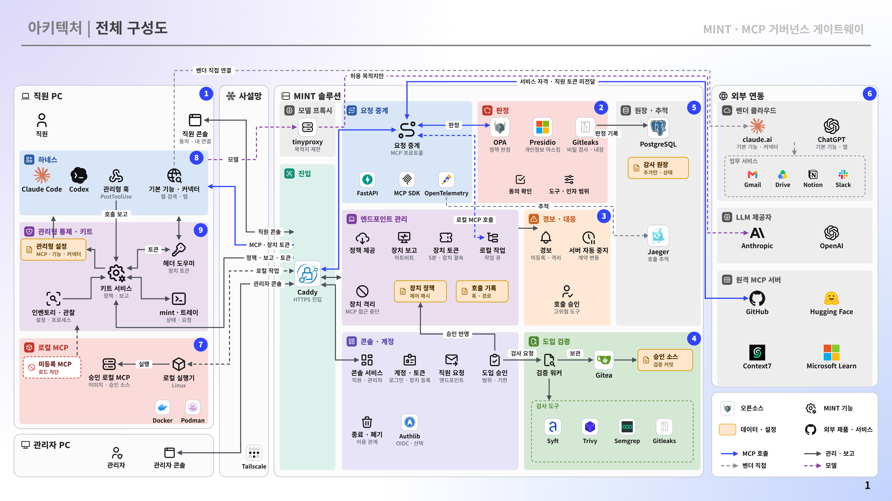

<div align="center">


# MINT

**MCP 거버넌스 게이트웨이**

**한국어** · [English](README.en.md)

[](https://github.com/MCP-governance/mcp-gateway/actions/workflows/verify.yml)
[](https://github.com/MCP-governance/mcp-gateway/actions/workflows/codeql.yml)


</div>

MINT는 직원 PC의 AI 코딩 에이전트(Claude Code·Codex CLI)의 관리형 MCP 연결을 회사가 승인한 것으로 한정하고, 게이트웨이를 지나는 도구 호출을
**실행 전에** 판정합니다. MCP를 쓰려면 직원이 신청하고 공급망 검사를 거쳐 다른 관리자가 승인합니다. 호출마다 신원·도구 분류·입력 검사·정책·동의를 확인하고,
응답의 개인정보와 비밀 정보를 가린 뒤 모든 판정을 덧붙이기만 하는 감사 원장에 남깁니다. 직원 PC 키트는 하네스의 관리형 설정을 배포해
승인된 경로만 쓰게 하고, 이용 관계를 끝내면 즉시 차단한 뒤 회수 여부를 증거로 판정합니다.

<p align="center">
  
</p>

<p align="center"><sub><a href="docs/ai/architecture/v2-1101/p02.png">영역 구분</a> · <a href="docs/ai/architecture/README.md">전체 29쪽·생성기</a></sub></p>

## 지원 범위

| 하네스 | 상태 |
| --- | --- |
| Claude Code | 지원 |
| Codex CLI | 지원 |
| Gemini CLI · OpenCode | 실습 스택에서 시험 |

| 직원 PC | 설치 | 상태 |
| --- | --- | --- |
| Linux (Ubuntu 20.04~26.04) | 명령 한 줄, sudo 1회 | 지원 |
| Windows 11 | 파일 하나, UAC 1회 | 지원 |
| macOS | 명령 한 줄 | 시험 |

| 서버 | 요구 사항 |
| --- | --- |
| 게이트웨이 서버 | Linux x86_64, Docker Engine 24+, Docker Compose v2 |

## 5분 설치

설치 예시는 공개 판본 `v0.9.0` 기준입니다. 이 README의 최신 코드 설명에는 [미배포 변경](CHANGELOG.md#미배포)이 포함됩니다.

```bash
git clone --branch v0.9.0 https://github.com/MCP-governance/mcp-gateway.git
cd mcp-gateway/deploy
./install.sh --bind <사내 IPv4>
```

설치가 끝나면 `https://<사내 IPv4>/`에서 관리자 `root`로 로그인합니다. 초기 비밀번호는 `deploy/initial-admin-password`에 있고,
`./mint.sh set-password root`로 바꿉니다. 요구 사항·구성·옵션은 [deploy/README.md](deploy/README.md)를 봅니다.

## 직원 PC 연결

1. 직원이 콘솔에 로그인 → **PC 연결 설정**에서 자기 OS의 키트를 받습니다.
2. 키트를 실행하고 MINT 계정으로 로그인합니다(Linux·macOS는 명령 한 줄, Windows는 파일 하나). 키트에는 게이트웨이 주소·루트 인증서·지문이 있고 직원별 등록 토큰은 없습니다.
3. 기본 간편 모드는 설치 점검과 조직의 자동 활성화 설정에 따라 활성화됩니다. 격리 계정 모드는 관리자가 **사용자·엔드포인트**에서 활성화합니다. 이용 동의는 로그인한 콘솔에서 서버·도구 범위를 확인해 처리합니다.

직원은 `mint`의 터미널 화면이나 `mint ui`의 로컬 화면에서 상태·MCP 서버·호출 기록·도입 요청을 봅니다.
`mint servers`, `mint logs [번호]`, `mint requests`, `mint request`, `mint sources [서버]`, `mint login`, `mint console [페이지]`도 지원합니다.
승인 소스 MCP는 엔드포인트에서 stdio 프로세스로 실행하며, 공식 이미지의 엔드포인트 컨테이너 실행 경로도 유지합니다.

키트의 설치 내용·제거·문제 해결은 [엔드포인트 키트](endpoint-agent/README.md)에 있습니다.

## 운영

| 일 | 어디서 |
| --- | --- |
| MCP 도입 신청·승인 | 콘솔 **도입 신청**, **승인 대기** |
| 승인한 서버의 사용 대상·중지·철회 | 콘솔 **MCP 서버** |
| 엔드포인트 활성화·통제 상태 | 콘솔 **사용자·엔드포인트**, **MCP 서버 > 통제 범위** |
| 판정·동의·감사 조회 | 콘솔 **호출·감사 기록**, 관리자 **승인 대기 > 이용 동의**·직원 **이용 동의** |
| 커넥터·하네스 기본 기능 | 콘솔 **MCP 서버 > 커넥터**, **정책 > 하네스 기능** |
| 계정·비밀번호 | `./mint.sh add-account`, `./mint.sh set-password` |
| 백업·복구·업그레이드·롤백 | `./mint.sh backup`·`restore`·`upgrade` — [운영 런북](docs/ai/RUNBOOK.md) |
| 판본별 변경 | [CHANGELOG.md](CHANGELOG.md) |

대시보드는 처리할 일·시간대별 판정·서버별 호출·최근 경보를 표시합니다. 호출 상세는 경로·정책 판정·도구 실행·업무 결과를 나누며,
경보 기간·묶음·미열람 수, 엔드포인트 검색과 상세·필터·페이지 주소 복원을 제공합니다. 이 조회 기능의 배포·실기기 검수 범위는 [개발 현황](research/llm-wiki/status/current.md)에서 확인합니다.

운영 배포의 기본은 독립 승인입니다. `ROOT_SOLO_APPROVAL=1`인 단독 운영 모드에서는 최고 관리자 `root`가 본인 신청과 높은 위험 등급의 2인 조건을 강제 집행하며,
원장에 별도로 기록합니다. 매우 높은 위험 등급의 서면 사유는 그대로 필요합니다. 현장 기본 관리자 `admin1`~`admin3`의 기본 비밀번호는 첫 실행 뒤 바꾸며, 운영 배포는 기본 비밀번호가 남은 계정을 중지합니다.

## 보안 경계

- **신원은 전송 계층의 토큰에서만** 정합니다. 인자·헤더·클라이언트가 보고한 값은 기록만 하고 판정에 쓰지 않습니다.
- **직원 토큰을 업스트림 MCP로 넘기지 않습니다.** 서버별 자격은 게이트웨이가 따로 보관하고, 직원이 연결한 자격은 조직 키로 암호화합니다.
- **판정할 수 없으면 막습니다.** 정책 엔진·검사기·계약 확인이 실패하거나 분류를 모르면 차단합니다.
- **게이트웨이는 자기 경로를 지나는 호출만 통제합니다.** 관리되지 않는 계정·키트가 없는 PC·벤더 기본 커넥터는 엔드포인트·네트워크·벤더 관리 설정의 몫이며, 콘솔에 통제 상태로 표시합니다.
- **기본 기능·기본 커넥터는 기본 승인이고 항목별 차단을 관리형 설정에 반영합니다.** 벤더 직접 경로는 게이트웨이의 호출 전 판정을 거치지 않습니다. Claude Code·Codex의 관리형 호출 후 훅은 이름·크기·해시·실패를 중앙에 보고하며 미등록 MCP 관측은 경보로 남깁니다. 기록 삭제·훅 실행 누락 가능성이 있어 완전한 호출 수집이나 호출 전 차단 증거는 아닙니다.
- **종료 판정은 공개된 증거로 내린 판단입니다.** 제공자의 실제 회수를 검증하는 것은 아닙니다.

세부 위협 모델과 한계는 [보안 경계](docs/ai/SECURITY_BOUNDARIES.md)에 있습니다.

## 개발·기여

- 설계: [docs/ai/ARCHITECTURE.md](docs/ai/ARCHITECTURE.md) · 결정 기록: [docs/ai/DECISIONS.md](docs/ai/DECISIONS.md) · 문서 지도: [docs/ai/README.md](docs/ai/README.md)
- 실습·검증 스택(합성 회사·직원 PC 4대·MCP 서버 10종): [full_stack_lab/](full_stack_lab/README.md)
- 개발 현황·작업 보고·실험 증거: [research/llm-wiki/](research/llm-wiki/README.md)
- 기여 규칙과 깨면 안 되는 불변식: [AGENTS.md](AGENTS.md). 변경은 작업별 브랜치에서 하고, 사용자에게 보이는 변경은 `CHANGELOG.md`의 「미배포」에 적습니다.
- 로컬은 정적 검사와 일회성 OPA 시험까지만 합니다. 솔루션은 솔루션 기기의 `./console.sh field up`으로만 띄우고, 실제 하네스 시험은 지정 시험 PC에서 합니다. CI는 정적 검사·비밀 스캔·일회용 스택·운영 설치를 검증하며, 문서 전용 PR은 무거운 작업을 생략할 수 있습니다.

## 라이선스

이 저장소에는 아직 오픈소스 라이선스가 지정되어 있지 않습니다. 저작권자의 허락 없이 복제·배포·수정할 수 없습니다.
포함된 제3자 구성요소(OPA, Presidio, Caddy, Gitea, PostgreSQL 등)는 각자의 라이선스를 따릅니다.
