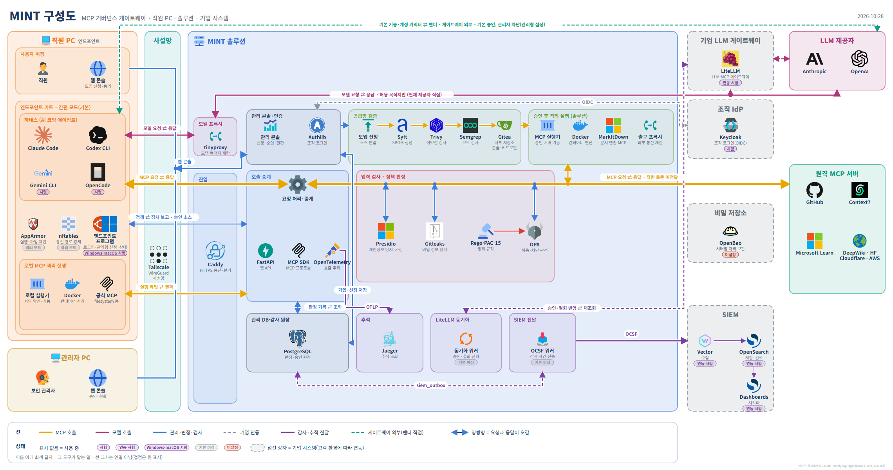

<div align="center">


# MINT

**MCP 거버넌스 게이트웨이** — 직원 PC의 AI 에이전트가 쓰는 MCP 도구 호출을 실행 **전에** 판정하고, 모든 판정을 감사 원장에 남깁니다.

**한국어** · [English](README.en.md)

[](https://github.com/MCP-governance/mcp-gateway/actions/workflows/verify.yml)
[](https://github.com/MCP-governance/mcp-gateway/actions/workflows/codeql.yml)


</div>

<p align="center">
  
</p>

<p align="center"><sub>왼쪽에서 오른쪽으로 도구 호출이 지나는 순서입니다. 양방향 화살표는 요청과 응답이 오가는 길이고, 이름 아래 회색 글자는 그 도구가 맡는 일입니다.
영역별 설명이 붙은 판은 <a href="docs/ai/architecture/mint-architecture-roles-ko.png">역할 설명 구성도</a>, 편집 원본은 <a href="docs/ai/architecture/mint-architecture-ko.drawio">draw.io</a>입니다.</sub></p>

---

## 왜 MINT인가

Claude Code·Codex 같은 코딩 에이전트는 MCP 서버로 파일·저장소·사내 문서·외부 서비스를 직접 다룹니다.
직원마다 다른 MCP를 붙이면 회사는 **누가, 어떤 도구로, 어떤 데이터를, 어디로 보냈는지** 알 수 없습니다.
MINT는 모든 MCP 연결을 게이트웨이 한 곳으로 모으고, 직원 PC에서 그 길을 우회하지 못하게 강제합니다.

- **들어오기 전에** — 쓰려는 MCP를 신청하면 공급망 검사 뒤 사람이 승인합니다. 처음 본 도구 계약은 자동 승인하지 않습니다.
- **실행하기 전에** — 호출마다 신원·자원 분류·입력 검사·정책 판정·동의를 거칩니다. 판정할 수 없으면 막습니다.
- **돌려주기 전에** — 응답에서 개인정보·비밀 정보를 가리고 계약에 맞는지 확인합니다.
- **끝낼 때** — 이용 관계를 닫으면 즉시 차단하고, 회수했다고 말할 수 있는지를 증거로 판정합니다.

## 주요 기능

| 기능 | 내용 |
| --- | --- |
| **도입 심사** | GitHub 저장소·원격 MCP 주소 신청 → Syft·Trivy·Semgrep 검사 → 사내 Gitea 반입 → 원클릭 승인(도구별 읽기·쓰기 분류, 사용 기한, 데이터 등급) |
| **호출 전 판정** | OPA/Rego 정책과 PAC-15 실행 범위, 승인된 입력 스키마, 목적 결속, 서버 간 전달 제한, 호출량·중복 실행 제한 |
| **입력·출력 검사** | Presidio(개인정보), Gitleaks(비밀 정보), 텍스트 규칙, 도구 설명 오염 검사. 검사 도구가 멈추면 차단 |
| **이용 동의** | 직원이 서버 단위로 데이터 이용에 동의·철회. 도구별 기록은 원장에 남음 |
| **엔드포인트 강제** | 직원 PC 키트가 관리 계정·AppArmor·nftables로 MCP 통신이 게이트웨이만 지나게 강제하고, 설정 위변조·우회 리스너를 보고 |
| **로컬 MCP 격리 실행** | 승인된 로컬 MCP(공식 filesystem·memory 등)를 직원 PC에서 서명 확인 뒤 Docker 격리로 실행. 폴더는 지정한 것만 마운트 |
| **감사 원장** | 모든 판정·승인·동의를 해시 체인 원장에 덧붙이기만. OpenTelemetry 추적, OCSF로 SIEM 전달 |
| **종료 판정** | 이용 관계 종료 시 즉시 차단, 회수 증거로 C1~C4 → T1~T3 판정 |
| **기업 연동** | 조직 IdP(OIDC), LiteLLM 승인·철회 동기화, SIEM — 고객 환경에 맞춰 켜는 선택 연동 |
| **운영 콘솔** | 한국어·영어 전환, 다크 모드, 라벨과 값만 보이는 화면 |

## 동작 방식

도구 호출 한 건이 지나는 길입니다. 구성도의 빨간 번호와 같습니다.

1. **하네스 호출** — Claude Code·Codex CLI가 관리 계정에서 MCP 도구를 부릅니다. 엔드포인트가 그 밖의 길을 막습니다.
2. **HTTPS 진입** — Tailscale 사설망을 지나 Caddy가 HTTPS를 끝내고 호출 중계로 보냅니다.
3. **입력 검사** — 전송 토큰으로 신원을 정하고, Presidio·Gitleaks로 입력을 검사·마스킹합니다.
4. **정책 판정** — OPA가 Rego·PAC-15 규칙으로 허용·차단·승인 필요를 판정하고, 필요하면 직원 동의를 받습니다.
5. **MCP 서버 전달** — 승인된 서버로만 중계합니다. 직원 토큰은 넘기지 않고 서버별 자격을 씁니다.
6. **응답 검사·기록** — 응답을 검사·마스킹해 돌려주고, 판정과 결과를 PostgreSQL 원장에 남깁니다.

## 구성 요소

| 영역 | 오픈소스 | 맡는 일 |
| --- | --- | --- |
| 직원 PC | Claude Code · Codex CLI (Gemini CLI · OpenCode 시험) | AI 코딩 에이전트(하네스) |
| | AppArmor · nftables · 엔드포인트 프로그램 | 실행·파일 제한, 통신 경로 강제, 정책 적용·보고 |
| | Docker · 로컬 실행기 | 승인된 로컬 MCP 격리 실행 |
| 사설망 | Tailscale | PC와 솔루션을 잇는 WireGuard 사설망 |
| 진입 | Caddy · tinyproxy | HTTPS 종단·경로 분기, 모델 목적지 제한 |
| 관리 콘솔 | FastAPI · Authlib | 신청·승인·현황 화면, 조직 로그인(OIDC) |
| 공급망 검증 | Syft · Trivy · Semgrep · Gitea | SBOM, 취약점 검사, 코드 검사, 사내 저장소 |
| 격리 실행 | Docker · MarkItDown · 출구 프록시 | 승인 서버 실행, 문서 변환 MCP, 외부 통신 제한 |
| 호출 중계 | FastAPI · MCP Python SDK · OpenTelemetry | 웹 API, MCP 프로토콜, 호출 추적 |
| 검사·판정 | Presidio · Gitleaks · OPA | 개인정보 탐지·가림, 비밀 정보 탐지, 허용·차단 판정 |
| 기록·전달 | PostgreSQL · Jaeger | 판정·승인 원장, 추적 조회 |
| 기업 연동(선택) | Keycloak · LiteLLM · OpenBao · Vector · OpenSearch | 조직 IdP, LLM 게이트웨이, 비밀 저장소, SIEM |

## 빠른 시작

솔루션 기기(Docker Compose·Tailscale이 있는 Linux/WSL2)에서:

```bash
git clone https://github.com/MCP-governance/mcp-gateway.git
cd mcp-gateway/full_stack_lab
./console.sh field up
./console.sh field status
```

- 브라우저 콘솔: `http://<Tailscale IP>:8000/login`
- 하네스·키트: `https://<Tailscale IP>` — `./console.sh field ca`로 배치 루트와 SHA-256 지문을 확인하고 [CA 배포 절차](docs/ai/FIELD.md#현장-tls와-루트-배포d-124)를 따릅니다.
- 첫 설치 계정은 관리자 `root`/`root`, 직원 `user`/`user`입니다. 시험이 끝나면 `./console.sh field set-password root`로 바꿉니다.

### 처음 쓰는 흐름

1. **도입 신청** — 직원이 콘솔에서 GitHub 저장소나 원격 MCP 주소를 신청합니다. 공식 MCP(filesystem·memory·sequentialthinking)는 PC 격리 실행 설정이 미리 채워집니다.
2. **승인·등록** — 다른 관리자가 검사 결과를 보고 도구별 분류·데이터 등급·기한을 정해 원클릭으로 승인합니다.
3. **내 PC 연결** — 직원이 개인별 키트를 받아 설치합니다(Linux, Windows 단일 파일, macOS 명령). 관리자가 엔드포인트를 활성화합니다.
4. **사용** — 하네스에 승인된 MCP가 나타납니다. 처음 쓸 때 서버 단위로 이용 동의를 한 번 합니다.
5. **종료** — 이용 관계를 닫으면 즉시 차단하고 회수 증거로 판정합니다.

명령·계정·문제 해결은 [RUNBOOK](docs/ai/RUNBOOK.md), 실습용 회사 스택은 [full_stack_lab](full_stack_lab/README.md)을 봅니다.

## 실제 MCP로 검증

자체 제작 mock MCP로 기능을 입증하지 않습니다. 실제 공개 MCP를 도입·승인해 실제 직원 PC의 하네스로 확인합니다.

| 실행 위치 | MCP |
| --- | --- |
| 원격 | GitHub · Context7 · Microsoft Learn · DeepWiki · Hugging Face · Cloudflare Docs · AWS Knowledge |
| 솔루션 격리 실행 | MarkItDown |
| 직원 PC 격리 실행 | filesystem · memory · sequentialthinking (modelcontextprotocol/servers 공식 이미지) |

최근 실사용 시험: [로컬 MCP 3종 PJ1 완주](research/llm-wiki/status/reports/2026-10-23-real-usage-local-mcp.md).

## 원칙

구현이 바뀌어도 유지하는 것입니다. 이것을 바꿔야 한다면 기능보다 원칙을 먼저 다시 논의합니다.

1. **신원은 전송 계층의 토큰에서만** 정합니다. 인자·헤더·클라이언트가 보고한 값은 기록만 하고 판정에 쓰지 않습니다.
2. **직원 토큰을 업스트림 MCP로 넘기지 않습니다**(MCP 인가 명세의 토큰 전달 금지).
3. **판정할 수 없으면 막습니다.** 정책 엔진·검사기·계약 확인이 실패하거나 분류를 모르면 차단합니다.
4. **사람이 승인합니다.** 처음 본 도구 계약을 자동 승인하지 않고, 신청자와 승인자는 다릅니다.
5. **감사 원장은 덧붙이기만** 합니다. 판정 기록을 고치거나 지우지 않습니다.
6. **꺼진 것과 회수된 것은 다릅니다.** 종료는 차단이 먼저이고, 회수는 증거로 판정합니다.
7. **실제 것으로 검증합니다.** 시험 대상 MCP는 상용 또는 공개 OSS 구현만 씁니다.

에이전트용 세부 불변식은 [AGENTS.md](AGENTS.md#깨면-안-되는-불변식), 바뀔 수 있는 선택과 그 이유는 [DECISIONS.md](docs/ai/DECISIONS.md)에 있습니다.

## 문서

| 경로 | 내용 |
| --- | --- |
| [docs/ai/](docs/ai/README.md) | 설계([ARCHITECTURE](docs/ai/ARCHITECTURE.md))·보안 경계·정책·종료 모델·시험·결정 기록 |
| [docs/ai/architecture/](docs/ai/architecture/README.md) | 구성도 원본(draw.io·SVG·PNG, 한/영)과 생성기 |
| [research/llm-wiki/](research/llm-wiki/README.md) | 개발 현황, 작업 보고, 요구사항 분석, 실험 증거 |
| [full_stack_lab/](full_stack_lab/README.md) | 게이트웨이·콘솔·정책·시험·실습 스택 |
| [endpoint-agent/](endpoint-agent/README.md) | 직원 PC 설치 키트와 엔드포인트 에이전트 |
| [AGENTS.md](AGENTS.md) | 이 저장소에서 일하는 사람·에이전트의 규칙 |

현재 상태는 [개발 현황](research/llm-wiki/status/current.md)을 기준으로 합니다. 날짜가 붙은 문서는 그 시점의 기록입니다.

## 현황과 한계

- **배치** — Tailscale IP 전용, 사설 CA HTTPS. 하네스는 키트가 배포한 루트를 신뢰해야 합니다.
- **강제 범위** — 게이트웨이는 강제 경로 **안의** 호출을 통제합니다. 비관리 계정·키트가 없는 PC·벤더 기본 커넥터는 엔드포인트·네트워크·벤더 관리 설정이 맡고, 화면에 우회 가능으로 표시합니다([보안 경계](docs/ai/SECURITY_BOUNDARIES.md)).
- **엔드포인트** — Linux 키트는 실기기로 검증했습니다. Windows 단일 파일 설치와 macOS 키트는 코드·시험까지이고 실기기 검증이 남았습니다.
- **연동** — LiteLLM 동기화·SIEM 전달은 기본 꺼짐이고, OpenBao 연동은 아직 없습니다.
- **종료 판정** — 제공자의 실제 회수를 검증한 것이 아니라 공개된 증거로 내린 판단입니다.
