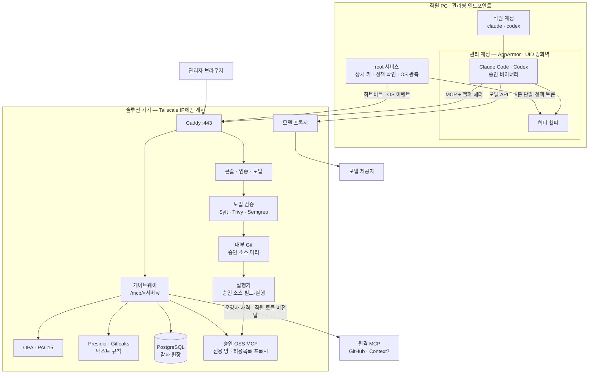

# MINT — MCP 거버넌스 게이트웨이

직원 PC의 AI 하네스(Claude Code·Codex CLI 등)가 쓰는 MCP 연결을 한곳으로 모아, 도구 호출을 **실행 전에** 판정하고
모든 판정을 감사 원장에 남기며, MCP 이용 관계를 **끝냈다고 말할 수 있는지**까지 판정하는 게이트웨이입니다.

## 구성



도구 호출 한 건은 게이트웨이 안에서 아래 순서를 거칩니다. 어느 단계든 판정할 수 없으면 차단하고, 결과는 모두 감사 원장에 남습니다.


예전 실습 스택(BoB Corp·MCP 10종·직원 PC 4대)의 구성도는 [docs/ai/architecture.html](docs/ai/architecture.html)에 이력으로 남아 있습니다.

## 원칙

### 깨지지 않는 것

아래는 구현이 어떻게 바뀌어도 유지합니다. 이것을 바꿔야 하는 상황이면 기능보다 원칙을 먼저 다시 논의합니다.

1. **신원은 전송 계층의 토큰에서만** 정합니다. 인자·헤더·클라이언트가 보고한 값(하네스 이름 등)은 기록만 하고 판정에 쓰지 않습니다.
2. **직원 토큰을 업스트림 MCP로 넘기지 않습니다**(MCP 인가 명세의 토큰 전달 금지).
3. **판정할 수 없으면 막습니다.** 정책 엔진·검사기·계약 확인이 실패하거나 분류를 모르면 차단입니다. 검사 도구가 죽었는데 통과하는 경로를 만들지 않습니다.
4. **사람이 승인합니다.** 처음 본 도구 계약을 자동 승인하지 않고, 신청자와 승인자는 다릅니다. 관리자도 승인 범위 밖 호출은 실행할 수 없습니다.
5. **감사 원장은 덧붙이기만** 합니다. 판정 기록을 고치거나 지우는 코드를 쓰지 않습니다.
6. **꺼진 것과 회수된 것은 다릅니다.** 종료는 차단이 먼저이고, 회수는 증거로 판정합니다(C1~C4 → T1~T3).
7. **실제 것으로 검증합니다.** 시험 대상 MCP는 상용 또는 공개 OSS 구현만 쓰고 자체 제작 mock MCP로 기능을 입증하지 않습니다.
   솔루션은 솔루션 기기에서 띄우고, 기능 확인은 실제 직원 PC(PJ1)의 실제 하네스로 합니다.

에이전트용 세부 불변식은 [AGENTS.md](AGENTS.md#깨면-안-되는-불변식)에 있습니다.

### 바뀔 수 있는 것

그 밖의 것은 현재의 선택이며 근거가 생기면 바꿉니다. 바꿀 때는 [DECISIONS.md](docs/ai/DECISIONS.md)에 D-번호로 이유와
되돌릴 조건을 남기고, [개발 연구 위키](research/llm-wiki/README.md)의 현황을 갱신합니다.

| 영역 | 지금의 선택 |
| --- | --- |
| 정책 | OPA/Rego, 팀원 제공 PAC15와 검토된 capability, 계약 해시 잠금 |
| 검사 | Presidio(개인정보), Gitleaks(비밀), 텍스트 규칙(PCRE2 네이티브), 도구 설명 검사 |
| 신원 | 솔루션 계정, Keycloak OIDC 연동, 관리형 단말의 5분짜리 단말·정책 결합 토큰 |
| 엔드포인트 | Linux 관리 계정 + AppArmor + UID 방화벽 + 모델 도메인 프록시, Windows 계정 SID 방화벽 |
| 도입 | 격리 워커의 Syft·Trivy·Semgrep 검증, 내부 Gitea 미러, 원격 MCP 계약 검토 |
| 실행 | 승인한 소스는 실행기가 고정 레시피로 빌드·실행(전용 망, 심사 목적지만 나가는 프록시) |
| 배치 | 솔루션 기기 한 대, Tailscale IP에만 게시 |
| 화면 | 게이트웨이·엔드포인트 용어, 라벨과 값만 보이는 운영 콘솔 |

## 실행

솔루션 기기(Docker Compose·Tailscale이 있는 Linux/WSL2)에서:

```bash
git clone https://github.com/MCP-governance/mcp-gateway.git
cd mcp-gateway/full_stack_lab
./console.sh field up
./console.sh field status
```

접속은 `https://<Tailscale IP>/login`입니다. `field ca`로 배치 루트·SHA-256 지문을 확인하고 [CA 배포 절차](docs/ai/FIELD.md#현장-tls와-루트-배포d-124)를 따릅니다. 첫 설치 계정은 관리자 `root`/`root`, 직원 `user`/`user`이고
시험이 끝나면 바꿉니다.

```bash
./console.sh field set-password root
```

처음에는 등록된 MCP 서버가 없습니다. 흐름은 다음과 같습니다.

1. **도입 신청** — 직원이 GitHub 저장소나 원격 MCP 주소를 신청합니다. 저장소는 자동 검증(SBOM·취약점·코드 규칙·종료 조건)을 거칩니다.
2. **승인·실행·등록** — 다른 관리자가 승인하면 저장소는 내부 Git으로 미러됩니다. 소스 신청은 관리자가 "실행"을 누르면 솔루션이 검증한 커밋을 고정 레시피로 빌드해 띄웁니다(레시피가 있는 저장소, [D-114](docs/ai/DECISIONS.md)). 관리자가 도구별 권한·데이터 등급·기한을 정해 그 주소를 게이트웨이에 등록합니다.
3. **내 PC 연결** — 직원이 개인별 키트를 받아 설치하고, 다른 관리자가 엔드포인트 집행을 확인한 뒤 활성화합니다.
4. **사용** — 하네스는 `/mcp/<서버>/`로 호출하고, 게이트웨이가 판정·실행·응답 검사·감사를 합니다.
5. **종료** — 이용 관계를 닫으면 즉시 차단하고 회수 증거로 판정합니다.

명령·계정·문제 해결은 [RUNBOOK](docs/ai/RUNBOOK.md), 실습용 회사 스택(`./console.sh up`)은 [full_stack_lab](full_stack_lab/README.md)을 봅니다.

## 문서

| 경로 | 내용 |
| --- | --- |
| [docs/ai/](docs/ai/README.md) | 설계([ARCHITECTURE](docs/ai/ARCHITECTURE.md))·보안 경계·정책·종료 모델·시험·결정 기록 |
| [research/llm-wiki/](research/llm-wiki/README.md) | 개발 현황, 작업 보고, 요구사항 분석, 실험 증거 |
| [최근 검토와 다음 작업](research/llm-wiki/analysis/review-2026-10-15/README.md) | 코드 관찰·위험 후보·공식 근거·Claude 인계와 검수 조건 |
| [팀 Drive 자료의 개발 연결](research/llm-wiki/analysis/drive-curation/README.md) | 원본 판본 비교, 정책 50개·MVP 기능 24개와 현재 검수 목표의 관계 |
| [full_stack_lab/](full_stack_lab/README.md) | 게이트웨이·콘솔·정책·시험·실습 스택 |
| [endpoint-agent/](endpoint-agent/README.md) | 직원 PC 설치 키트와 엔드포인트 에이전트 |
| [AGENTS.md](AGENTS.md) | 이 저장소에서 일하는 사람·에이전트의 규칙 |

날짜가 붙은 문서(`*_2026-10-01.md` 등)는 그 시점의 기록입니다. 현재 상태는 [개발 현황](research/llm-wiki/status/current.md)을 기준으로 합니다.

## 한계

- Tailscale IP 전용 사설 CA HTTPS 배치입니다. 하네스는 키트의 검증된 루트를 신뢰해야 하며 Windows 전용 설치기 통합과 실기기 TLS 검수는 별도입니다.
- 게이트웨이는 강제 경로 **안의** 호출을 통제합니다. 경로 밖(비관리 계정·관리형 설치가 없는 PC·벤더 기본 커넥터)은
  엔드포인트·네트워크·벤더 관리 설정이 맡으며 화면에 우회 가능으로 표시합니다([보안 경계](docs/ai/SECURITY_BOUNDARIES.md)).
- 종료 판정의 결론은 제공자의 실제 회수를 검증한 것이 아니라 공개된 증거로 내린 판단입니다.
- 실제 관리 Claude의 선별 호출은 확인됐고, Codex 하네스·Windows 실기기·전체 조건 검수는 남아 있습니다. 확인 범위는 [현황](research/llm-wiki/status/current.md)에서 구분합니다.
