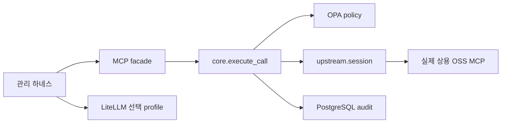
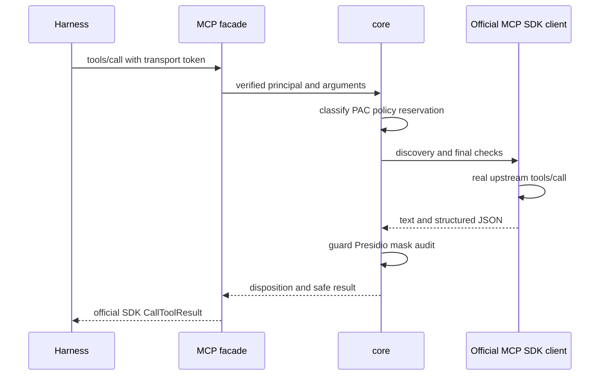
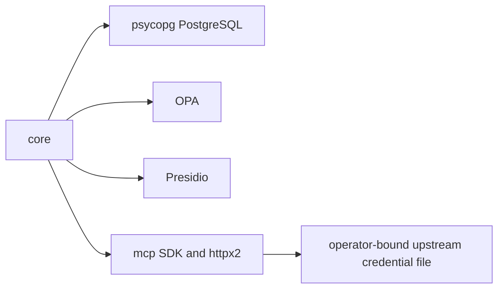
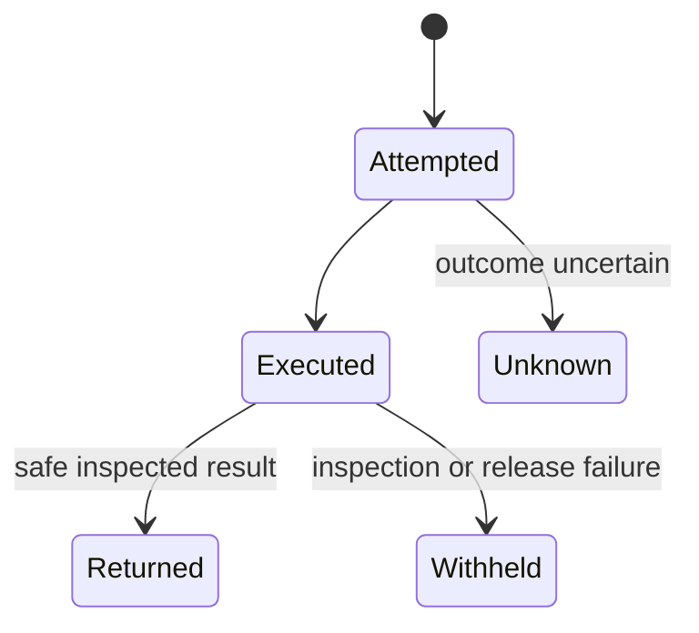

# 코드 구조와 실제 호출 경로

Microsoft 공개 wiki-researcher/wiki-architect의 파일·함수 근거와 구조/흐름/연동/반례/종합 관점을 선별 적용했다. [고정 원문·라이선스·적용 범위](skill-candidates.json)를 보존했으며 전체 plugin 설치나 외부 helper 실행은 하지 않았다. 기존 Git remote와 브랜치가 확인돼 있으므로 동일 질문을 반복하지 않는다.

## 1. 구조

FastAPI HTTP 입구는 [main.py](../../../full_stack_lab/gateway/app/main.py), MCP SDK 입구는 [mcp_facade.py](../../../full_stack_lab/gateway/app/mcp_facade.py)다. 기업 LLM 요청과 MCP 요청은 별도 입구다. endpoint-agent는 실제 Linux UID/AppArmor/nftables와 관리 설정을 다룬다.

근거: main의 route 등록, facade `build_mcp`, core `execute_call`/`_call_upstream`, upstream `session`, compose llm profile. L→M은 현재 확인된 연결이 아니므로 그리지 않았다.

| 구조 목록 | 확인 수준 |
| --- | --- |
| 40개 모듈·640개 함수 | AST 전수 구조 목록. 동적 호출 해결/전체 본문 감사 아님 |
| 16단계 경로 | 각 심볼·실제 시작/끝 행·hash는 code-structure.json pipeline |
| 기존 미커밋 파일 | worktree_modified와 HEAD hash를 병기; 배포판으로 추정하지 않음 |

## 2. 데이터와 상태

`_caller`→`authenticated_user`의 transport 신원으로 시작한다. `execute_call`은 분류·PAC·OPA를 적용하고 `_call_upstream`에서 실제 계약·기기 상태·현재 권한·정책을 다시 검사한다. upstream 직원 JWT 전달은 하지 않는다. 결과는 `_guarded_result`→`_inspected_result`(Presidio와 전체 결과 Gitleaks)→`_render`로 전달하며 원장은 실행과 응답 상태를 구분한다.

| 경계 | 실행 조건 |
| --- | --- |
| OPA/계약/관리형 입구 오류 | 실행 전 차단. 다른 정책의 차단을 원하는 통제의 통과로 세지 않음 |
| upstream 실행 뒤 결과 오류 | 응답 보류. 이미 일어난 쓰기/전송이 취소됐다고 주장하지 않음 |
| 구조화 JSON | 검사된 값 보존, key·숫자 PII 보류, 전체 결과 Secret 검사, decoded key/값 주입 검사, NaN/Inf 거부. 미지원 rich content는 계속 보류 |

## 3. 연동

| 관찰 | 근거·해석 |
| --- | --- |
| field LiteLLM 미활성 | Compose llm profile·litellm.yaml 존재와 실제 기동은 별도 |
| HTTP upstream | upstream.session은 Streamable HTTP. ingress stdio가 upstream stdio 실행 지원을 뜻하지 않음 |
| private LLM Gateway 공백 | model-domains.txt는 제공자 도메인 목록. 고객 private LiteLLM host/CA/포트 정책 별도 필요 |
| 비밀 저장소 | credential_headers는 정확 endpoint/principal/기한의 별도 공급자 자격 파일 계약. Vault/Cloud SDK 배선 완료 아님 |

## 4. 반례와 이번 수정

| 발견 | 수정/남은 조건 |
| --- | --- |
| 안전한 structured 결과가 facade에서 누락 | 공식 CallToolResult의 structuredContent 보존, 구형 text fallback |
| 보류/차단과 잔존 result의 모순 | 명시 허용 상태+returned/masked만 반환 |
| dict key의 PII는 값 마스킹으로 제거되지 않음 | 전체 키 한 번에 공식 analyzer 검사, schema 키를 바꾸지 않고 응답 보류 |
| outputSchema·resources/prompts 등 | 승인/잠금·검증 경로는 별도 미충족 조건. 이번 수정으로 전체 MCP 명세 지원 주장 금지 |

## 5. 종합과 팀 온보딩

새 팀원은 `AGENTS.md`→위키 현황→analysis 요구사항→pipeline→해당 함수/시험→실험 target 순서로 읽는다. 기업 도입 검토자는 요구사항의 통과 기준·공백·효과 증거와 연동50조건부터 읽는다. 조사를 이어갈 때 조건별 반례/버전/읽은 범위를 추가하고 현재 source_only를 검증 완료로 승격하지 않는다.

| 우선 작업 | 완료 기준 |
| --- | --- |
| 실제 OSS MCP 정상군·독립 효과 | provider quota/자격 문제를 분리하고 정상 본문·수신·효과 확보 |
| LiteLLM 모델과 MCP 연동 | 별도 discovery/model 응답을 넘어 같은 fresh 관리형 자연어 turn의 요청·효과 연결 |
| 권한·secret·승인·경쟁·회수 | 요구사항과 연동 조건의 정확 정상/음성/경계/복구·provider 증거 |

메타데이터·AST의 전수 목록이 인간의 전체 코드 감사나 모든 기업 조건 충족을 대신하지 않는다. 검토가 끝난 범위를 수치와 함께 계속 기록한다.
